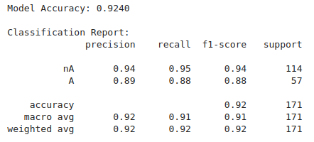
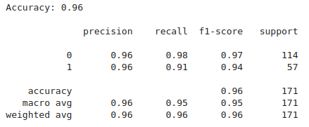
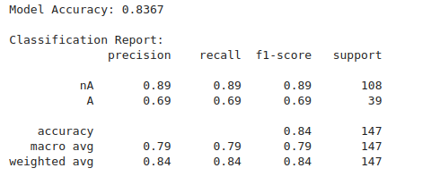
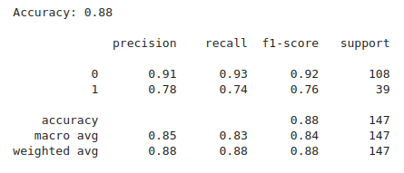
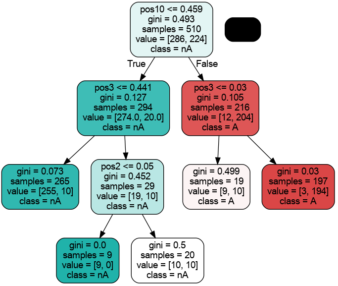
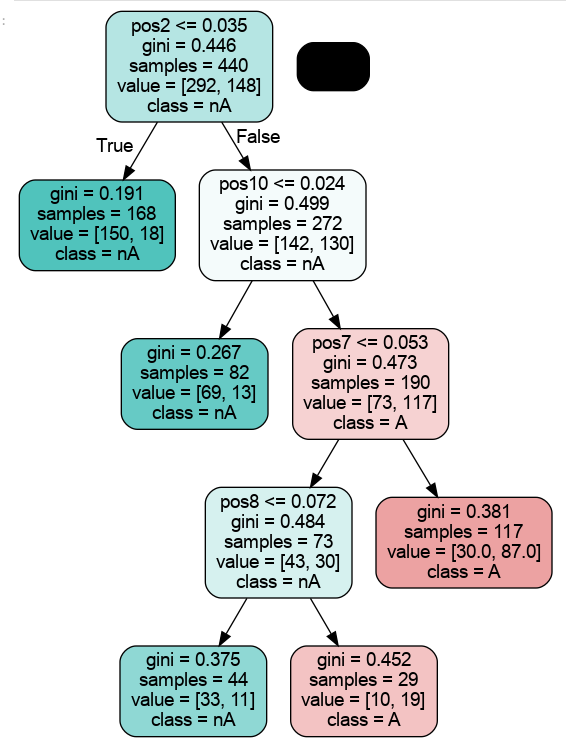

## Input data description

## DT Model description

Derived position specific occurrence of amino acids serves the positional feature value to train the ML models - DT and RF.
HLA type A antigen epitope dataset is used as input.
Negative dataset is derived from fragments of protein sequences which are not antigens.

### Performance summary - 

| DT performance matrix for HLA Type A1| RF performance matrix for HLA Type A1 |
| :---: | :---: |
|  |  |

| DT performance matrix for HLA Type A| RF performance matrix for HLA Type A |
| :---: | :---: |
|  |  |

## HMM model description
Transition of amino acids is recorded as transition matrix. The order of transition is decided as per the user. Current study uses 1st order of transition among the amino acids in the antigen epitope library.

Emission probability matrix is derived as per the derived decision rule from the decision tree. 

Both probability matrices are used to generate synthetic antigen epitopes. 

## Distance based hydrophobicity profile

Euclidean distance based hydrophobicity profile of the selected antigen epitope types are generated and is used to cluster then based on cutoff limit.
The distance value is further used to access the significance level of amino acids substitutions and generate mutagenic antigen epitope library. 

## Overall framework

## Preliminary result 

| DT for HLA A1 | DT for HLA A |
| :---: | :---: |
|  |  |

Decision rule:
TM:
EP:
Synthetic peptides: 
PC analysis:

## License & Permissions
Copyright (c) 2026 [Ambarish Kumar]. All rights reserved. 

No commercial or private use, reproduction, or distribution of this code is permitted without explicit written permission. If you would like to use this project, please open an Issue in this repository or contact me at [er.ambarish@gmail.com] to request permission.
